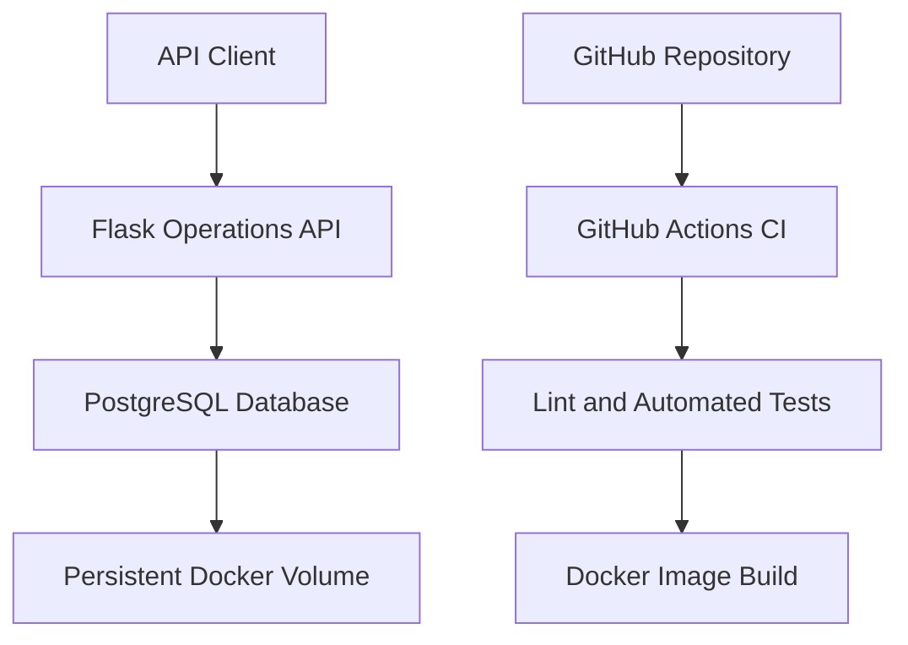

# Apex Operations API — DevOps Assessment

## 1. Project Overview

This project demonstrates the containerization, testing, deployment, and operational management of a simple Operations API.

The application uses Flask and PostgreSQL, runs in Docker containers, and uses GitHub Actions for automated quality checks and Docker image builds.

The implementation focuses on reproducibility, service health, database persistence, CI quality gates, and operational reliability.

## 2. Architecture



## 3. Technology Stack

- Python 3.12
- Flask
- PostgreSQL 17
- Docker
- Docker Compose
- Gunicorn
- Pytest
- Ruff
- GitHub Actions

## 4. Application Endpoints

| Method | Endpoint | Purpose |
|---|---|---|
| GET | `/health` | Checks whether the API process is alive |
| GET | `/ready` | Checks whether the API can connect to PostgreSQL |
| GET | `/operations` | Retrieves stored operations |
| POST | `/operations` | Creates a new operation |

The API validates incoming requests and returns appropriate HTTP status codes.

## 5. Local Setup and Deployment

### Prerequisites

- Docker Engine
- Docker Compose
- Git

### Clone the repository

```bash
git clone https://github.com/matt7869/apex-devops-assessmen
Create a local `.env` file:

```bash
echo "POSTGRES_PASSWORD=replace_with_a_local_password" > .env
```

Do not commit `.env` or expose credentials.

### Start the application

```bash
docker compose up --build -d
```

### Check service status

```bash
docker compose ps
```

### Verify application health

```bash
curl -i http://localhost:8000/health
curl -i http://localhost:8000/ready
```

### View application logs

```bash
docker compose logs -f api
```

### Stop the application

```bash
docker compose down
```

The named PostgreSQL volume is retained when the stack is stopped this way. Avoid `docker compose down -v` when database data must be preserved.

## 6. Testing and Code Quality

Run automated tests:

```bash
python -m pytest -v
```

Run lint checks:

```bash
python -m ruff check app tests
```

The test suite currently contains six automated tests covering API health and invalid request handling.

Manual integration checks also verified database connectivity, operation creation and retrieval, and persistence after database container recreation.

## 7. Continuous Integration

GitHub Actions runs on pushes and pull requests targeting `main`.

The workflow:

1. Checks out the repository.
2. Sets up Python 3.12.
3. Installs dependencies.
4. Runs Ruff lint checks.
5. Runs automated tests.
6. Builds the Docker image only after the quality job succeeds.

A failed quality job prevents the Docker build job from running.

## 8. Container Security

The API container:

- Runs as a dedicated non-root user.
- Uses a slim Python base image.
- Excludes local secrets and development files through `.dockerignore`.
- Receives database configuration through environment variables.

The local development password is not committed to Git.

Production deployment should use a managed secrets service, least-privilege database credentials, and automated dependency and image vulnerability scanning.

## 9. Monitoring and Operational Readiness

Implemented:
- API health endpoint.
- Database-backed readiness endpoint.
- Application exception logging.
- PostgreSQL container health check.

Proposed production enhancements:
- Structured JSON application logs.
- Centralized log aggregation.
- Metrics for request rate, latency, error rate, and database connections.
- Alerts for elevated HTTP 5xx responses, failed readiness checks, and database unavailability.
- Container and dependency vulnerability scanning.

## 10. Deployment and Rollback Strategy

The local Docker Compose environment demonstrates application deployment.

The release strategy uses versioned Docker image tags rather than relying exclusively on a mutable `latest` tag.

Rollback should redeploy the previous known-good image version and verify API health, readiness, and database connectivity.

The rollback procedure and evidence will be documented separately as part of the assessment.

## 11. Assessment Scope

This implementation has been built and tested locally. GitHub Actions CI has successfully passed linting, automated tests, and Docker image build checks.

No production Apex infrastructure or real customer data was used. Production monitoring, cloud hosting, and vulnerability scanning are recommendations unless explicitly demonstrated in the repository.

## 12. AI Assistance Disclosure

AI assistance was used for technical explanations, troubleshooting guidance, documentation support, and review of implementation decisions. Commands, configuration, application behavior, and test results were checked in the local development environment by the project author.
## Versioned Release and Rollback Demonstration

### Release versions

Two Docker images were built locally:

- `apex-operations-api:v1` — the original API release.
- `apex-operations-api:v2` — an updated release that introduces the `/version` endpoint.

### Deploying v2

The Compose configuration was updated to use `apex-operations-api:v2`, and the API container was recreated.

The following checks were successful:

- `/health` — API returned a healthy response.
- `/ready` — API confirmed database connectivity.
- `/version` — returned `{"version":"2.0.0"}`.

### Rolling back to v1

The Compose configuration was switched back to `apex-operations-api:v1`, and the API container was recreated using:

```bash
docker compose up -d --force-recreate api
```

### Rollback verification

After rollback, the following results were observed:

| Check | Result |
|---|---|
| Running API image | `apex-operations-api:v1` |
| `/ready` | `{"status":"ready"}` |
| `/version` | HTTP 404 — expected because this endpoint is not present in v1 |
| `/operations` | Previously stored operation record returned successfully |
| PostgreSQL | Container healthy |

### Outcome

The rollback successfully restored the previous API image. The PostgreSQL database remained available, and the existing operation record was preserved.

This demonstrates a basic versioned release and rollback process using Docker images and Docker Compose, with persistent database storage maintained independently of the API container.
